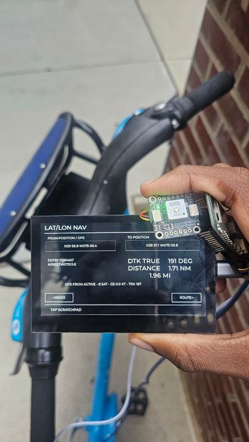
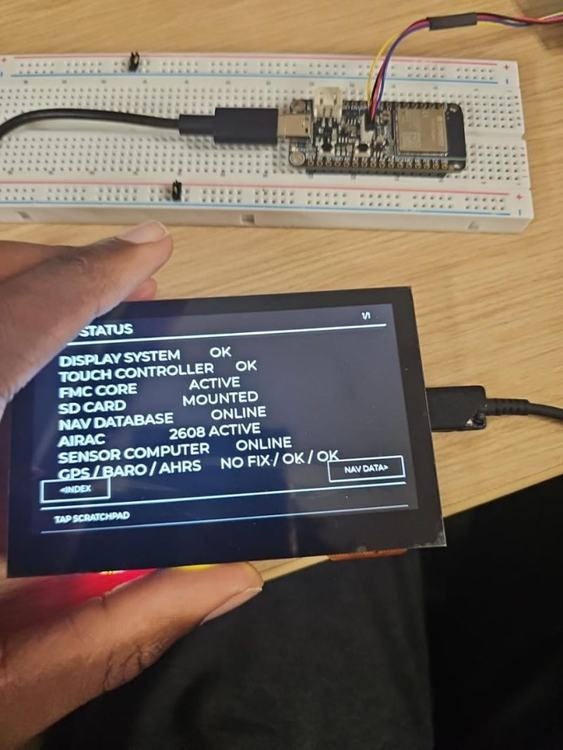
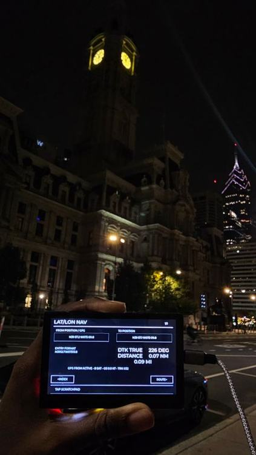
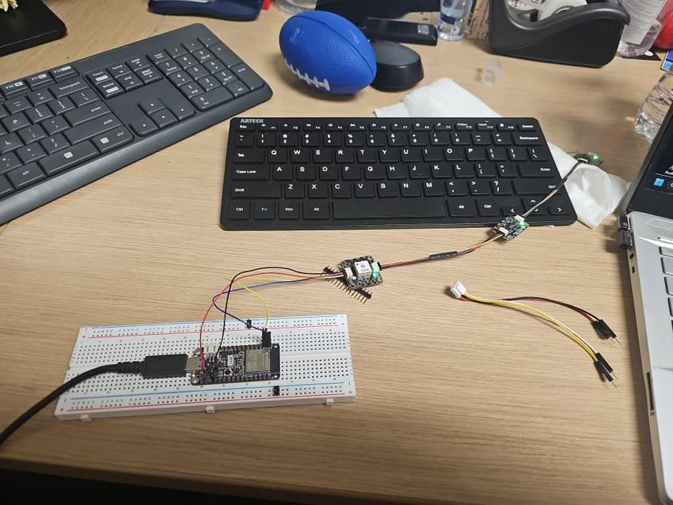
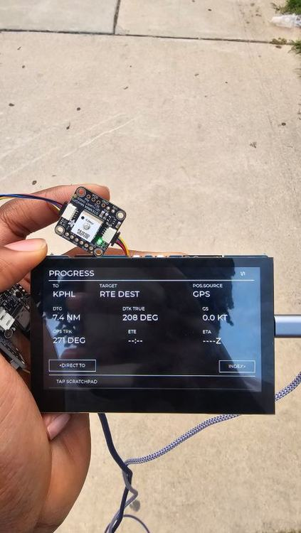

# ESP32-S3 Flight Management Computer

**Touchscreen avionics-style FMC/CDU prototype | ESP32-S3 · C++/Arduino · LVGL · ESP-NOW · GPS**

I'm developing a miniature flight management computer that combines a touchscreen control-display unit, flight-plan management, onboard navigation-data lookup, and live sensor telemetry. The project is built around a **Waveshare ESP32-S3-Touch-LCD-4.3**, with a separate **Adafruit ESP32-S2 Feather** acting as a wireless GPS and environmental/attitude sensor computer.

The focus is embedded systems integration: UI design, navigation calculations, reliable data exchange between microcontrollers, SD-card indexing, and debugging real hardware.

<p align="center">
  
</p>

## Engineering highlights

- **Touchscreen FMC interface:** MENU, IDENT, POS INIT, DEP/ARR, ROUTE, LEGS, DIRECT TO, PROGRESS, LAT/LON, NAV DATA, and STATUS pages using LVGL 8 on an **800 × 480 RGB display**.
- **Flight planning and navigation:** Origin/destination entry, route-leg insertion and deletion, discontinuities, waypoint lookup, runway/procedure selection where data is available, Direct-To, desired track, distance-to-go, and GPS-dependent ETE/ETA.
- **Two-microcontroller architecture:** A Feather sensor computer reads a PA1010D GPS, BME280 environmental sensor, and BNO085 orientation sensor, then broadcasts telemetry over **ESP-NOW, channel 6**.
- **Packet handling:** Versioned 24-field `AV1` frames, **CRC-16/CCITT** checking, receiver buffering, link-status monitoring, and timeout handling. The transmitter is configured to send every **100 ms (10 Hz)**.
- **Local navigation data:** Indexed airport, fix, runway, and procedure records on microSD; a separate Python builder combines a preconverted FAA NAVDATA base with OurAirports worldwide airport/runway/navaid overlays.
- **Board-level debugging:** Custom CH422G I/O-expander control for microSD chip select, avoiding the ESP32-S3 GPIO10 conflict with an RGB LCD data line.

## Prototype photographs

These photographs show my development hardware and examples of the FMC interface running on the device.

| System status & sensor interface | Nighttime LAT/LON navigation |
| --- | --- |
|  |  |
| On-device diagnostics for display, touch, navigation storage and sensor link. This capture shows GPS without a position fix. | Outdoor demonstration of the handheld navigation page. |

| Feather sensor prototype | Navigation progress page |
| --- | --- |
|  |  |
| Separate sensor-processing board and connected modules during bench development. | Destination, desired track, distance and GPS-dependent progress fields. |

The [larger outdoor navigation photo](assets/images/fmc-live-navigation.jpg) is shown at the top of this README. The STATUS image displays an **AIRAC 2608** development dataset; it is not a current navigation-data cycle.

## Hardware and system architecture

```text
  PA1010D GPS ───┐
  BME280 ────────┼──> ESP32-S2 Feather ── ESP-NOW / AV1 + CRC ──> ESP32-S3 FMC
  BNO085 ────────┘                                             │
                                                    ┌───────────┼───────────┐
                                                    │           │           │
                                               LVGL touch    Route &      microSD
                                               interface     nav logic     NAVDATA
```

**Display:** Waveshare ESP32-S3-Touch-LCD-4.3 with ST7262 RGB LCD and GT911 I²C touch controller.  
**Sensor computer:** Adafruit ESP32-S2 Feather with GPS, barometric/environmental sensing and orientation input.  
**Storage:** Indexed `/NAVDATA` files on microSD, selected via the CH422G I/O expander.

Detailed implementation notes: [Architecture](docs/ARCHITECTURE.md) · [Hardware interfaces](docs/HARDWARE.md) · [Feather transmitter](docs/FEATHER_SENSOR_COMPUTER.md) · [Packet and NAVDATA formats](docs/NAVDATA_AND_SENSOR_PROTOCOL.md)

## Repository layout

```text
FlightManagementComputer/    ESP32-S3 display firmware and board/LVGL port
SensorComputer/              ESP32-S2 Feather GPS/environment/AHRS transmitter
config/                      LVGL configuration
tools/                       FAA + OurAirports hybrid NAVDATA builder
tests/                       Python navigation-data builder tests
docs/                        Hardware, architecture, build and protocol notes
assets/images/               Photographs of the actual prototype
```

## Building and running

1. Install the **Espressif Arduino ESP32 board package** and the dependencies listed in [Build and dependencies](docs/DEPENDENCIES_AND_BUILD.md). The display firmware targets **LVGL 8.4.0** (not LVGL 9).
2. Place `config/lv_conf.h` where the LVGL 8 build can find it, following the [configuration instructions](docs/DEPENDENCIES_AND_BUILD.md).
3. Open `FlightManagementComputer/FlightManagementComputer.ino` in Arduino IDE; keep the associated `.h` and `.cpp` files in the same sketch directory.
4. Select an ESP32-S3 board profile and flash/PSRAM settings appropriate for the Waveshare 4.3-inch model. Use **115200 baud** for serial diagnostics.
5. For wireless telemetry, build and flash the [Feather sensor computer](docs/FEATHER_SENSOR_COMPUTER.md), using ESP-NOW **channel 6** on both boards.
6. To generate SD-card navigation data, follow the [world NAVDATA guide](docs/WORLD_NAVDATA.md). The builder requires a **preconverted FAA NAVDATA package**; it does not directly parse raw FAA CIFP.

The repository references its third-party Arduino dependencies instead of committing full library copies.

## Testing and development status

**Demonstrated in photographs:** FMC screens running on the physical Waveshare display, including navigation, progress and system-status pages, alongside the Feather development hardware.

**Automated/offline checks:** Three Python navigation-data builder unit tests passed, and the historical NAVDATA archive passed **21/21 SHA-256 manifest checks**. Run the unit tests with:

```bash
python -m unittest discover -s tests -v
```

**Next validation milestones:** Record a reproducible clean build with pinned board/library settings, capture dual-board ESP-NOW packet-delivery and CRC statistics, characterize GPS/attitude measurements, and exercise route/navigation behavior against known test cases. See the [verification plan](docs/TEST_PLAN.md).

The full generated SD database is kept outside Git because of its size, source provenance and update cycle. The historical **AIRAC 2608** snapshot expired in September 2026, and the project also includes a small built-in development database. Current aeronautical-data coverage and complete end-to-end operation have not been independently established.

## Development roadmap

- Document repeatable board/PSRAM settings and hardware test results.
- Expand route/navigation unit tests and separate navigation math and parsing from the main sketch.
- Capture live two-board wireless-link performance and sensor-calibration results.
- Refresh the FAA/OurAirports data-generation workflow with versioned inputs.
- Add a wiring diagram and a short hardware demonstration video.

## Scope and licensing

This is a **personal educational engineering prototype, not certified avionics**. It is not intended for operational flight planning or navigation. ESP-NOW CRC detects transmission errors but does not authenticate a transmitting device.

The application does not yet have a repository-wide open-source license. Bundled Espressif-derived port files retain their individual license notices; see [third-party acknowledgements](docs/THIRD_PARTY.md).
