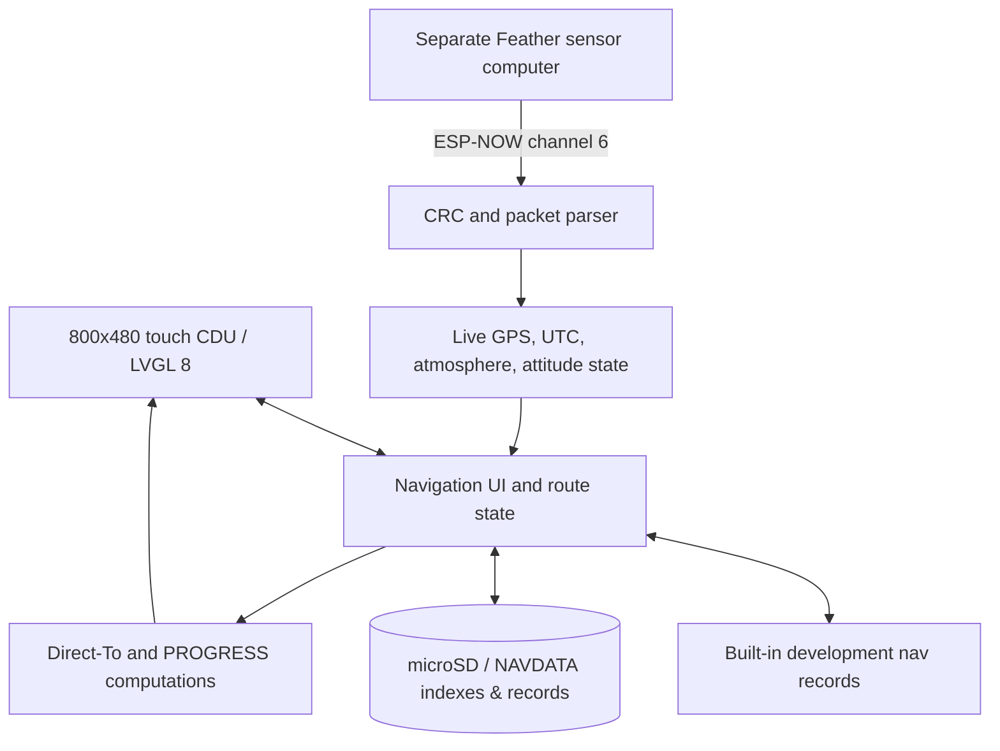

# System architecture

The following diagram reflects the provided firmware; it does **not** imply that all interfaces were tested with this source-only archive.

## Application layers (currently in a single main sketch)

**Presentation and event handling:** LVGL widgets and callbacks for CDU menu, IDENT, position initialization, departure/arrival selection, route planning, navigation lookup, leg editing, Direct-To, and progress. Most navigation/UI logic currently resides inside `FlightManagementComputer.ino` rather than separate modules.

**Navigation state and lookup:** route origin/destination, scratchpad, manual/insertion legs, route discontinuities, SID/STAR selection, navdata records, and coordinate formatting. The code maintains an in-memory test database and a separate SD indexed-record lookup path.

**Live sensor ingest:** `setupSensorEspNow()` initializes station-mode Wi-Fi and ESP-NOW on a fixed channel; `onSensorEspNowReceive()` copies packets into a shared buffer under a critical section. `serviceSensorBus()` then parses them in the main loop, avoiding LVGL work inside the Wi-Fi callback.

**Display and OS integration:** the Espressif-derived `lvgl_v8_port.*` sets display/touch callbacks, buffer allocation, and timer/task synchronization. `esp_panel_board_custom_conf.h` provides this board's RGB LCD, touch and I/O expander configuration.

**Storage and electrical integration:** a CH422G expander selects the card, while SPI provides data to the card. The sketch intentionally avoids using the ESP32-S3 default GPIO10 chip-select, which is connected to an LCD blue data bit on this board.

## Potential refactoring boundaries

Future work could extract `NavigationMath`, `RouteState`, `NavdataReader`, `SensorProtocol`, and `CDUViews` into independently testable modules. This is a **proposal**, not a claim that these modules exist in the current code.
